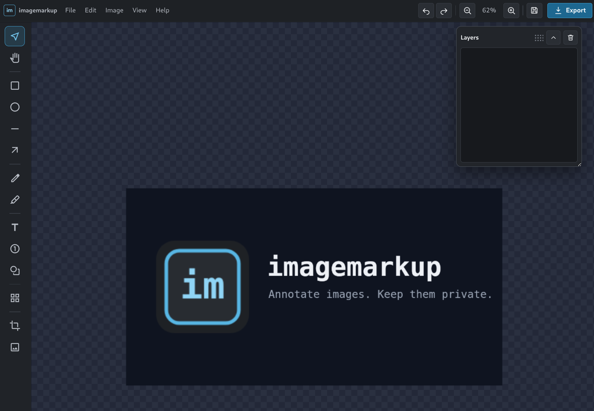

# imagemarkup

[](https://github.com/bradsec/imagemarkup/actions/workflows/tests.yml)
[](package.json)
[](LICENSE)
[](https://imagemarkup.com/)

Private, browser-based image annotation. Images stay on your device, and the built app runs on a static host.

**Live app: https://imagemarkup.com/**



## Features

- Load a base image from the centered button, paste it, or drop it on the editor; add more images as editable layers.
- Preserve transparent PNG pixels while editing, cropping, resizing, and exporting PNG files, including transparency behind marks.
- Turn on View > Rulers for horizontal and vertical rulers measured from the image origin in the units and resolution set in Preferences.
- Start a clean File > New project; it clears undo history so the previous image cannot be restored by mistake.
- Keep off-canvas artwork hidden by default, or enable View > Show overflow to reveal it and expand PNG exports with a transparent background.
- Set measurement units, document resolution, and a high-contrast selection color from File > Preferences. Preferences persist between browser sessions.
- Draw boxes, ellipses, lines, arrows, pen strokes, highlights, direct multiline text, counters, symbols, and pixelated, blurred, or solid-color redactions.
- Use standard stroke/fill color palettes, five quick thickness presets, custom colors, independent Stroke and Fill on/off controls, line caps and joins, independent start and end arrowheads in five styles, and a grouped, searchable visual symbol library. Symbols support separate fill and outline colors and adjustable outline width. Stars support 3 to 24 points and adjustable inner radius; the polygon symbol supports 3 to 12 sides. Numeric, letter, or Roman counter sequences can restart or continue from any value. Step counters have their own fill and border (with adjustable border width, or none), bold, italic, and underline text, and an independent text color, with standard presets, exact color inputs, and image pickers. Selecting an existing counter exposes its own value without changing neighbouring counters or the next sequence value.
- Create rich text with locally bundled Kalam, Inter, Roboto, Open Sans, Lato, Montserrat, Poppins, Merriweather, Libre Baskerville, and Oswald fonts; quick size presets; bold, italic, underline; left, center, right, or justified alignment; letter spacing in thousandths of an em; and line spacing as a font-size multiplier.
- Select, move, resize, rotate, restyle, reorder, delete, undo, and redo objects. Lines and arrows use a centerline selection with fixed-opposite endpoint grips, a midpoint rotation handle, and a four-way cursor because either endpoint can move freely. Type exact width and height values in the top bar or floating tool options panel using the preferred measurement unit, with an optional aspect-ratio lock. The independent floating Layers palette supports show/hide visibility, locking, contiguous Shift selection, non-contiguous Ctrl/Cmd selection, drag reordering, direct deletion, and right-click actions for renaming, duplicating, one-step reordering, or deleting a layer. Visibility and lock controls sit together on the left of each layer, while delete remains isolated on the right. Hold Shift while drawing or resizing to constrain proportions, Shift while rotating to snap to 45-degree increments, Alt/Option to draw or resize from the center, or combine modifiers where applicable.
- Crop, resize, rotate, flip, add borders, and apply angled text or image watermarks. Resizing the base image scales every existing annotation with it, including non-proportional resizing. Text watermarks support the installed and uploaded font library, bold, italic, and overlap-safe tiling.
- Autosave locally, import/export editable `.imgmarkup` projects, and upload local fonts.
- Export PNG or JPG at 1x/2x, with a contextual JPG quality control, download, or copy PNG to the clipboard.
- Mouse, keyboard, pen, and touch input, including cursor zoom and two-finger pinch/pan. On mobile, browser page zoom is disabled so pinch gestures remain dedicated to the image canvas and the editor controls stay reachable. Menus and dialogs fit the screen and scroll vertically when needed.
- The tool options panel shows a live sample above its controls.
- The Help menu has guides for tools and drawing, editing and layers, saving and exporting, and keyboard shortcuts. Guides open before an image loads.

### Using the editor

Open, save, transform, and export from the menu bar, or use the Save and Export buttons in the top bar. Pick a tool from the left rail, which appears once an image is loaded; the floating options panel then shows only the settings that apply to that tool or the selected object, with a preview tile that labels the size in pixels whenever a large setting has to be drawn scaled down, while the status bar shows only the relevant interaction hint. On phones, in either orientation, the tool options panel floats over the canvas and scrolls vertically. Choosing a tool opens it; touching the canvas to draw collapses it to its heading, and its heading button opens or collapses it. Only one of the options and Layers panels stays open at a time. Drag the panel by its heading to move it. The Layers palette floats separately, remains available throughout the project, and can be positioned and resized independently. Options panel positions are remembered per tool, and the Layers position is remembered globally. File > Reset settings restores panel positions, colors, arrowheads, text and counter defaults, selection color, and editor preferences without changing artwork. Each canvas item is represented by its own layer row; drawing adds a row and deleting it removes that item. Press Ctrl+D to duplicate selected items with a small offset. Drag either palette by its heading when it covers the part of the image you need, or resize Layers from its lower-right edge. Compact stroke and fill swatches dock at the bottom of the rail on narrow touch screens, while the options palette offers quick palettes and exact controls. Text font, formatting, and alignment remain the defaults for the current project. Choose the Text tool and click existing text to place a caret, edit, or highlight characters without opening a transform box; double-click text from Move for the same inline editor. Choose a common whole-pixel font size from the dropdown or enter a custom size. Add Font stores TTF, OTF, WOFF, or WOFF2 files locally in IndexedDB so they remain available in later sessions. Finishing a shape, line, arrow, symbol, or redaction returns to Move with the new object selected for immediate editing; pick the tool again to draw another. Pen, highlighter, and counter stay active and leave new marks unselected so you can draw or number in quick succession. Placing text opens its editor and returns to Move. Press Escape to finish inline text, leave the current tool or selection, and return to Move. Choose Move when you want to select and transform an object. The Crop tool provides Apply and Cancel controls as soon as a crop area is active; applying it clips intersecting layers to the new canvas and removes layers that fall completely outside. The About dialog provides the version, creator and asset credits, the GitHub repository, third-party licenses, and ways to support the project.

Open images and projects replace the current work after confirmation, and Undo restores the prior image and markup. Image tools and actions stay disabled until an image loads. Autosave failures stay visible in the status bar until a save succeeds.

When the image editing canvas has focus, common shortcuts include `V` for Move, `R` for Rectangle, `P` for Pen, `H` for Highlighter, `T` for Text, and arrow keys to move selected items by one pixel. Press Enter or Space with a placement tool to create an object at the viewport center. Click once to place a default-size shape or crop. Hold Space and drag to pan with any tool while the pointer is over the canvas, even after using a tool control. Text fields keep their normal Space behavior. Use Alt+ArrowUp or Alt+ArrowDown on a focused layer row to reorder it one step. Hold Shift with an arrow key to move by ten pixels. The mouse wheel zooms, and `Ctrl`/`Cmd` + `Z` undoes the last change.

Text letter spacing, line spacing, and symbol shape controls update selected objects and become the defaults for new objects. Drag a crop to draw it, then move it or use its eight resize handles. Crop ratios include Free, Original, 1:1, 4:3, 3:2, and 16:9, with an orientation swap; choosing either reshapes the current crop immediately. Arrow keys nudge the crop when the canvas has focus; Shift moves it ten pixels. Enter applies one undoable crop step, and Escape cancels it.

Numeric tool settings pair exact values with common-value pickers or sliders. Frame, watermark, export quality, and measurement resolution dialogs offer the same touch-friendly controls where useful; custom values remain editable.

## Structure

```
index.html          page metadata and app mount
src/core/          annotation models, geometry, history and serialization
src/fonts/         uploaded font storage
src/io/            image loading and project I/O
src/render/        canvas rendering and export
src/state/         editor state and autosave
src/ui/            shell, canvas host, panels and editor controls
src/controller.ts  editor setup and coordination
src/styles/       ordered base, workspace, dialog and responsive styles
public/            icons, bundled fonts, licenses and site metadata
scripts/           icon generation
e2e/               Playwright browser tests
```

## Develop

Requires Node.js 22.12 or newer and npm.

```sh
npm ci
npm run dev
```

Run the verification gate with:

```sh
npm test
npm run typecheck
npm run lint
npm run build
npx playwright install chromium webkit
npm run test:e2e
```

## Deploy

`npm run build` writes the complete static site to `dist/`. Deploy that directory to Cloudflare Pages, or any static host.

For Cloudflare Pages, connect the GitHub repository in the Cloudflare dashboard and use these build settings:

- Production branch: `main`
- Framework preset: Vite
- Build command: `npm run build`
- Build output directory: `dist`
- Root directory: leave blank to use the repository root
- Environment variable: `NODE_VERSION=22`

No Cloudflare API token or GitHub deployment secrets are required for this Git integration. Cloudflare builds and deploys the site when `main` changes. Add `imagemarkup.com` as the project's custom domain after the first deployment.

The tracked application version is stored in `package.json` and `package-lock.json`. Increment the patch version with `npm version patch --no-git-tag-version` as part of each release change. Vite places that version in the footer and About dialog during every build. The Tests badge points to the GitHub Actions workflow. Cloudflare deploys on push independently of CI, so a failed test does not block deployment.

## Browser support

The Playwright configuration tests desktop Chromium and WebKit on an iPhone 13 profile. The editor requires JavaScript and browser Canvas support. Local files stay in the browser; project autosave and uploaded fonts require browser storage.

## Acknowledgements and credits

imagemarkup has no third-party runtime JavaScript dependencies. It bundles these third-party assets for offline use:

- [Google Material Symbols](https://fonts.google.com/icons), licensed under the [Apache License 2.0](public/icons/material-symbols-LICENSE.txt).
- Legacy hand gesture paths retained for compatibility with existing `.imgmarkup` projects come from [Font Awesome Free](https://fontawesome.com), copyright Fonticons, Inc., and are licensed under [CC BY 4.0](public/icons/font-awesome-NOTICE.txt). They are not offered in the current symbol menu.
- Inter, Kalam, Lato, Libre Baskerville, Merriweather, Montserrat, Open Sans, Oswald, Poppins, and Roboto, licensed under the SIL Open Font License 1.1. Individual copyright notices and license texts are in [public/fonts/licenses](public/fonts/licenses).
- The GitHub mark from [Primer Octicons](https://github.com/primer/octicons), copyright GitHub, Inc., licensed under the [MIT License](public/icons/octicons-LICENSE.txt). Use of the GitHub logo follows [GitHub's logo guidelines](https://github.com/logos).

Development, testing, and build tooling:

- `@axe-core/playwright`, MPL-2.0.
- `@napi-rs/canvas`, MIT.
- Playwright, Apache-2.0.
- jsdom, MIT.
- oxlint and oxfmt, MIT.
- TypeScript, Apache-2.0.
- Vite, MIT.
- Vitest, MIT.

Exact installed versions and transitive dependency metadata are recorded in `package-lock.json`.

The bundled notices and license texts are also available in [THIRD-PARTY-LICENSES.txt](public/THIRD-PARTY-LICENSES.txt).

## License

imagemarkup is licensed under [MIT](LICENSE).
